# Unitree Go1: Ground-Supported Four-Gait Evaluation

**Course:** EEL 5669 — Introduction to Robotics  
**Team role:** Member 7 — Testing and Evaluation  
**Experiment date:** November 15, 2026  
**Platform:** Unitree Go1, Gazebo/ROS simulation  
**Gaits:** Walk, Trot, Canter, Gallop

## 1. Objective

Evaluate the stability and ground-contact consistency of four
implemented gaits before and after the team's ground-gait
controller improvements.

The evaluation focuses on:

1. Whether the robot remains upright on the ground.
2. Duration of operation before a gait-mode transition.
3. Maximum absolute body roll and pitch.
4. Body-height behavior.
5. Agreement between scheduled stance and detected contact.
6. Verification of commanded forward velocities.

## 2. Controller Versions

| Configuration | Git revision | Description |
|---|---|---|
| Original | `030c250` | Integrated controller before ground-gait fixes |
| Improved | `c472c21` | Tianyu Cheng's `ground-gaits-fix` controller |

Both configurations were tested in ground-supported Gazebo
simulation using `hang:=false`.

The improved controller modifies multiple aspects of gait
configuration and control. Therefore, the observed improvement
cannot be attributed to a single parameter without additional
controlled experiments.

## 3. Experimental Procedure

For the improved trials:

1. Launch Gazebo with the robot on the ground.
2. Start the keyboard controller.
3. Reset the forward, lateral, and yaw velocity commands to zero.
4. Enter STAND mode.
5. Begin recording the ROS bag.
6. Activate the selected gait at zero commanded velocity.
7. Gradually increase commanded forward velocity to 0.05,
   0.10, and 0.15 m/s.
8. Observe whether the robot remains upright at each stage.
9. Command STAND using the keyboard spacebar.
10. Stop the ROS bag recording and analyze the data.

The same nominal forward-velocity stages were verified from
recorded commands for the improved trials.

The original and improved trials were not matched-duration,
identical-speed experiments. Comparisons should therefore
be interpreted as descriptive, single-trial evidence.

## 4. Recorded Signals

The following ROS topics were recorded:

- `/gazebo/model_states`
- `/trunk_imu`
- `/go1_ctrl/gait_debug`
- `/go1_ctrl/mode`
- `/go1_ctrl/cmd_vel` (improved trials)
- `/visual/FR_foot_contact/the_force`
- `/visual/FL_foot_contact/the_force`
- `/visual/RR_foot_contact/the_force`
- `/visual/RL_foot_contact/the_force`

Body orientation was computed from the robot's Gazebo pose
quaternion using Euler angles.

The gait-debug message contains 10 values per leg, with the
leg order FR, FL, RR, RL. Scheduled stance and detected-contact
flags were extracted from indices 1 and 2 of each leg's block.

## 5. Definition of Evaluation Metrics

### 5.1 Maximum absolute body orientation

Maximum absolute roll:

`max(|roll(t)|)`

Maximum absolute pitch:

`max(|pitch(t)|)`

Roll and pitch are expressed in degrees.

### 5.2 Missed scheduled-contact rate

For each leg:

`Missed rate (%) = 100 * missed stance samples / scheduled stance samples`

A missed stance sample is defined as:

- Scheduled stance = 1
- Detected contact = 0

The overall rate combines the missed and scheduled sample counts
across all four legs.

This measurement represents disagreement between the contact
detector and the gait scheduler. It does not necessarily
indicate actual physical loss of ground contact.

### 5.3 Gait duration and outcome

Gait duration is measured from the recorded `GAIT <name>`
transition to the next mode transition.

A transition to PASSIVE following a fall is distinguished from
an operator-commanded return to STAND.

## 6. Original vs. Improved Results

| Gait | Original duration (s) | Improved duration (s) | Original outcome | Improved outcome |
|---|---:|---:|---|---|
| Walk | 5.1972 | 22.4464 | Fall / PASSIVE | Upright / commanded STAND |
| Trot | 4.0538 | 23.9282 | Fall / PASSIVE | Upright / commanded STAND |
| Canter | 1.9142 | 20.9000 | Fall / PASSIVE | Upright / commanded STAND |
| Gallop | 3.6164 | 18.3514 | Fall / PASSIVE | Upright / commanded STAND |

All four improved trials completed their planned observation
windows without an observed fall.

The improved durations are operator-terminated observation
durations, not measured maximum operating limits.

### 6.1 Maximum absolute roll

| Gait | Original (deg) | Improved (deg) |
|---|---:|---:|
| Walk | 58.47 | 1.765 |
| Trot | 58.62 | 0.822 |
| Canter | 59.95 | 2.370 |
| Gallop | 58.80 | 3.342 |

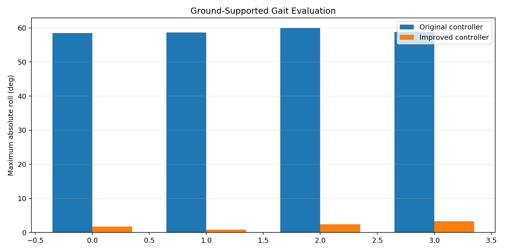

### 6.2 Maximum absolute pitch

| Gait | Original (deg) | Improved (deg) |
|---|---:|---:|
| Walk | 24.87 | 2.739 |
| Trot | 18.39 | 1.048 |
| Canter | 22.32 | 1.862 |
| Gallop | 20.15 | 3.166 |

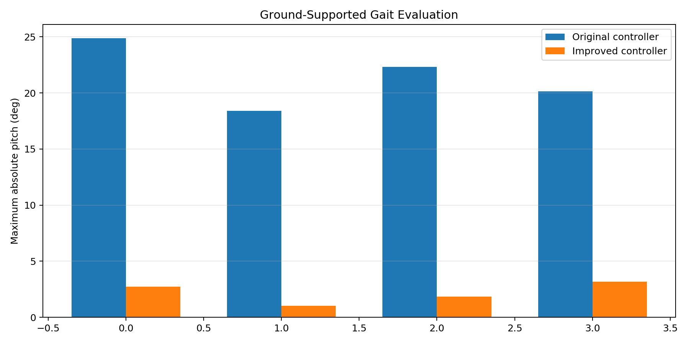

### 6.3 Missed scheduled-contact rate

| Gait | Original (%) | Improved (%) |
|---|---:|---:|
| Walk | 20.18 | 7.63 |
| Trot | 31.60 | 18.12 |
| Canter | 40.30 | 11.98 |
| Gallop | 41.00 | 11.73 |

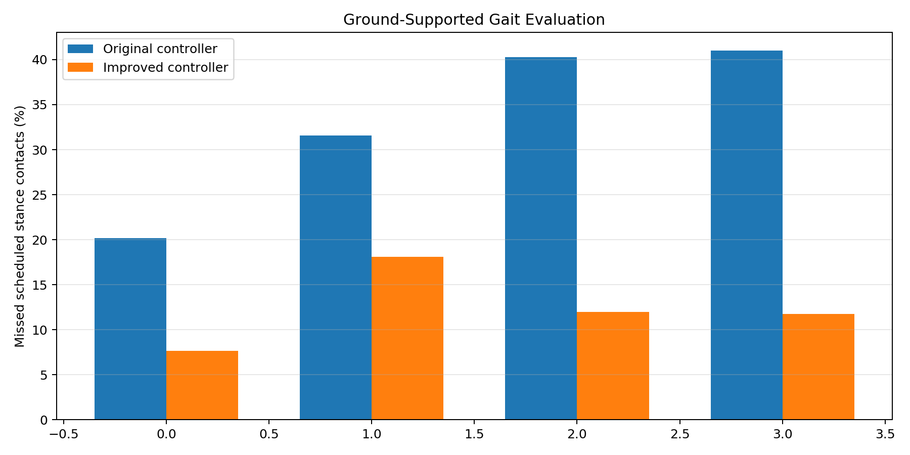

## 7. Improved Controller: Detailed Results

### 7.1 Walk

- Gait duration: 22.4464 s
- Maximum absolute roll: 1.765 deg
- Maximum absolute pitch: 2.739 deg
- Mean body height: 0.3680 m
- Minimum body height: 0.3561 m
- Maximum body height: 0.3766 m
- Overall missed-contact rate: 7.63%
- Final mode: STAND, commanded by operator

Walk achieved the lowest overall missed-contact rate among
the four improved trials.

Related plots:

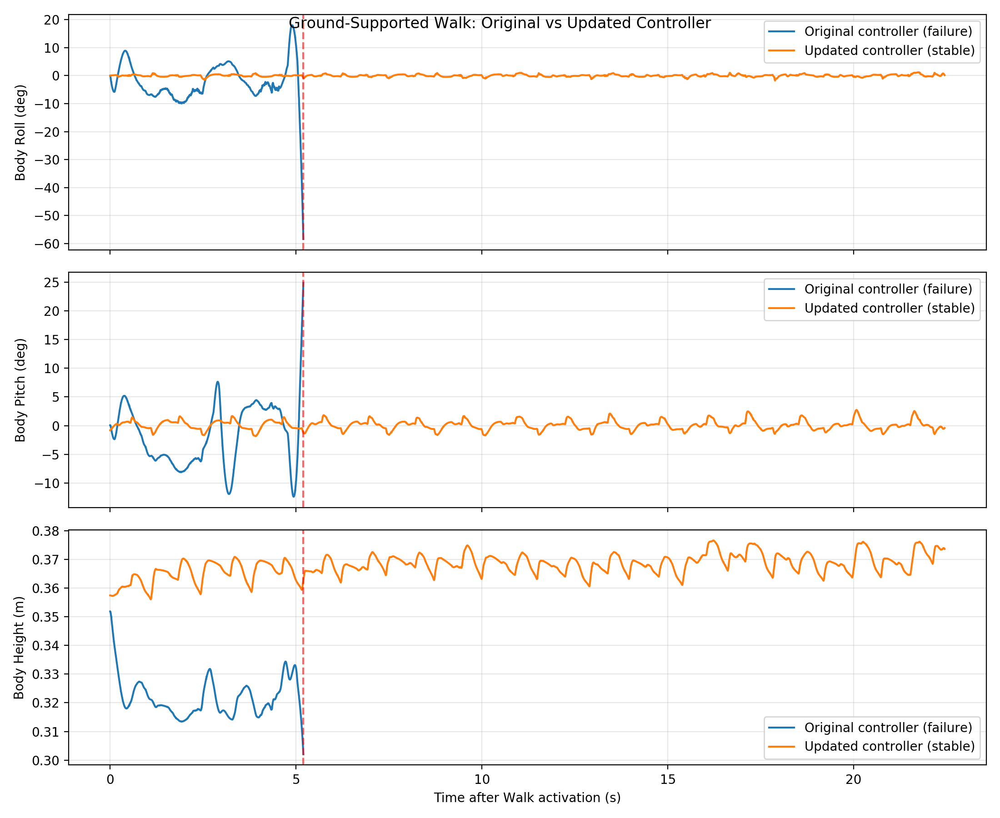

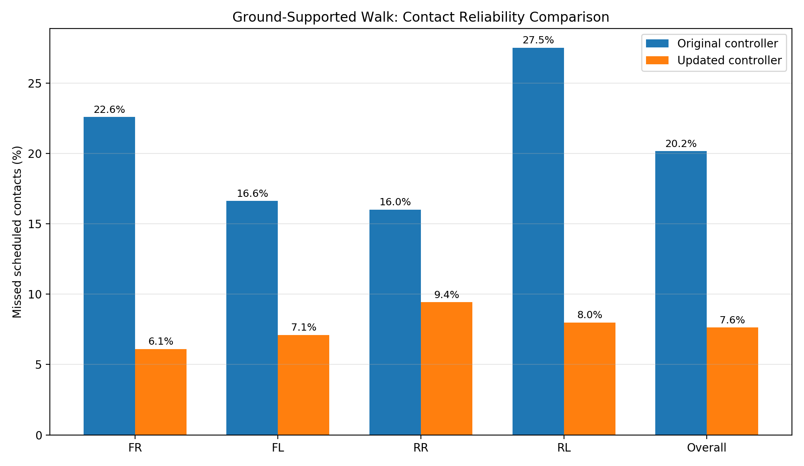

### 7.2 Trot

- Gait duration: 23.9282 s
- Maximum absolute roll: 0.822 deg
- Maximum absolute pitch: 1.048 deg
- Mean body height: 0.3685 m
- Minimum body height: 0.3481 m
- Maximum body height: 0.3785 m
- Overall missed-contact rate: 18.12%
- Final mode: STAND, commanded by operator

Trot achieved the smallest maximum absolute roll and pitch
among the four improved trials.

Per-leg missed scheduled-contact rates:

| Leg | Missed / Scheduled | Rate (%) |
|---|---:|---:|
| FR | 868 / 8354 | 10.39 |
| FL | 1632 / 8362 | 19.52 |
| RR | 2232 / 8362 | 26.69 |
| RL | 1326 / 8354 | 15.87 |

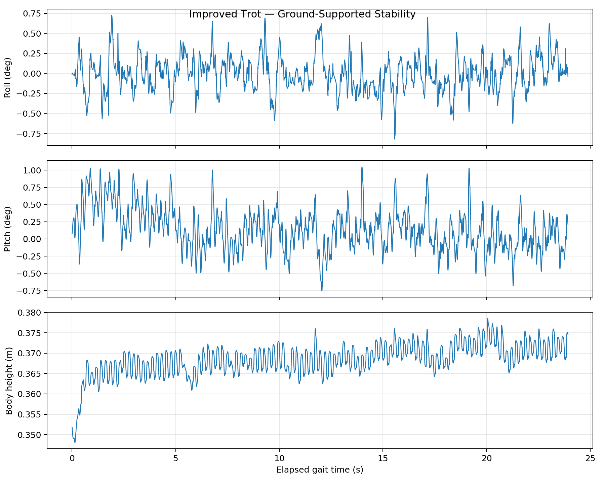

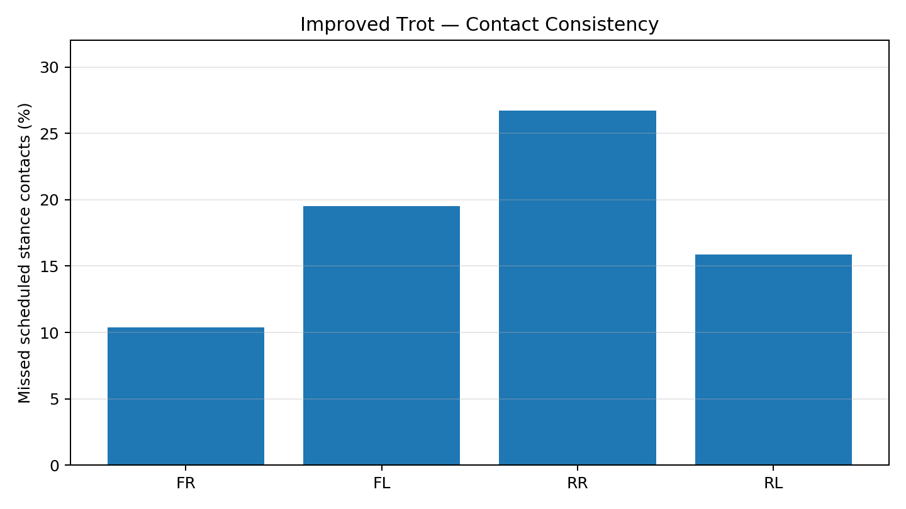

### 7.3 Canter

- Gait duration: 20.9000 s
- Maximum absolute roll: 2.370 deg
- Maximum absolute pitch: 1.862 deg
- Mean body height: 0.3770 m
- Minimum body height: 0.3489 m
- Maximum body height: 0.3848 m
- Overall missed-contact rate: 11.98%
- Final mode: STAND, commanded by operator

Per-leg missed scheduled-contact rates:

| Leg | Missed / Scheduled | Rate (%) |
|---|---:|---:|
| FR | 1585 / 7292 | 21.74 |
| FL | 188 / 7388 | 2.54 |
| RR | 173 / 7388 | 2.34 |
| RL | 1572 / 7295 | 21.55 |

The FR and RL legs show higher scheduled-contact mismatch
rates than the other diagonal pair.

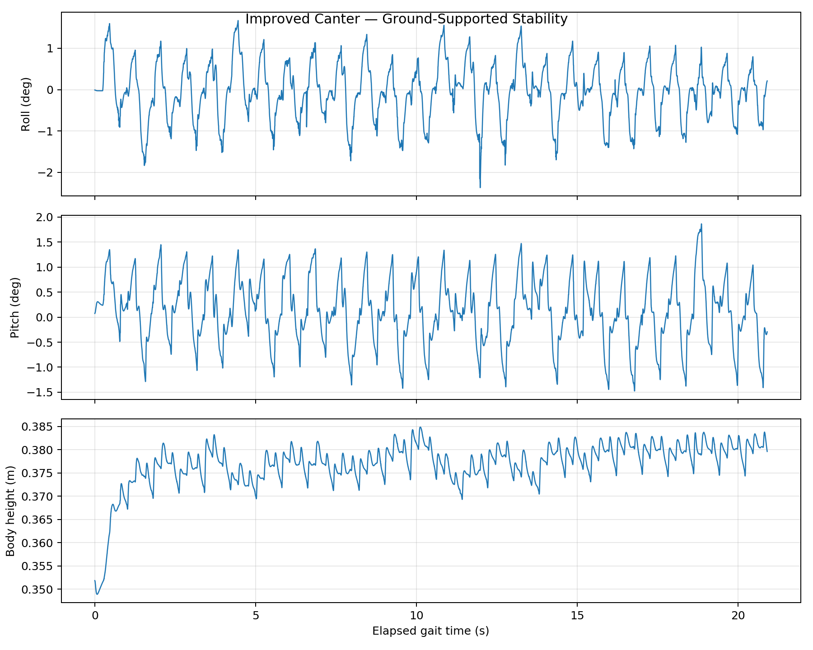

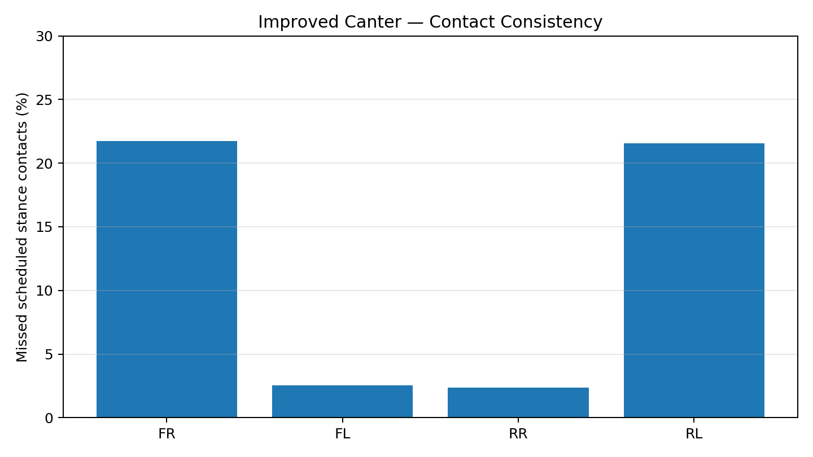

### 7.4 Gallop

- Gait duration: 18.3514 s
- Maximum absolute roll: 3.342 deg
- Maximum absolute pitch: 3.166 deg
- Mean body height: 0.3627 m
- Minimum body height: 0.3453 m
- Maximum body height: 0.3723 m
- Overall missed-contact rate: 11.73%
- Final mode: STAND, commanded by operator

Per-leg missed scheduled-contact rates:

| Leg | Missed / Scheduled | Rate (%) |
|---|---:|---:|
| FR | 1376 / 6394 | 21.52 |
| FL | 76 / 6410 | 1.19 |
| RR | 1516 / 6391 | 23.72 |
| RL | 33 / 6391 | 0.52 |

The right-side legs exhibit higher scheduled-contact mismatch
rates than the left-side legs in this trial.

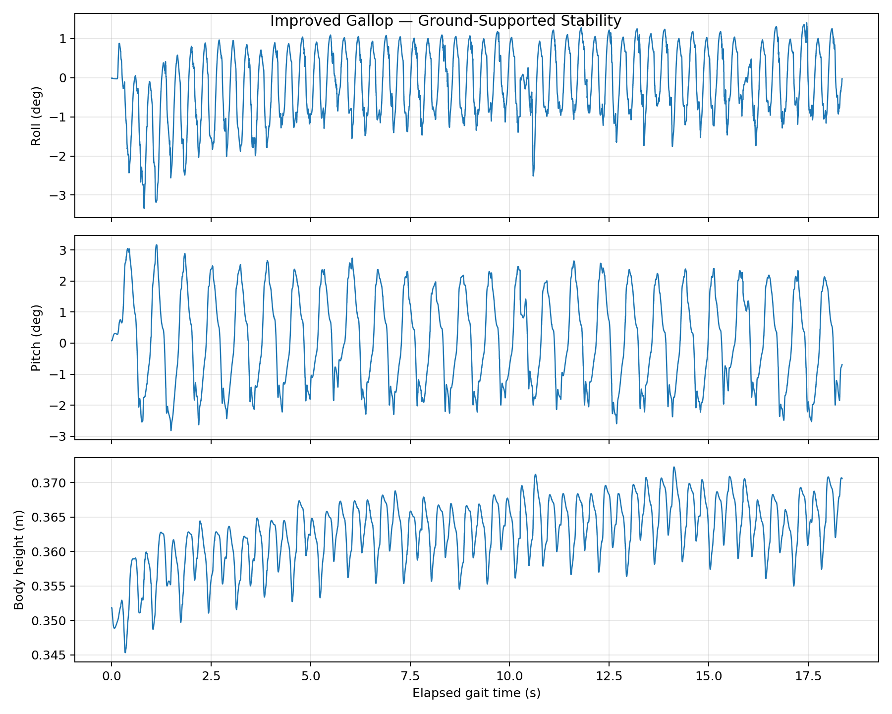

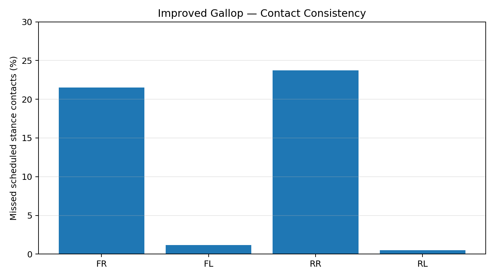

## 8. Main Findings

1. **Ground-supported operation improved:** The original
   controller fell in all four baseline trials, while the
   improved controller remained upright through the planned
   observation window for all four gaits.

2. **Body orientation improved substantially:** Maximum
   absolute roll and pitch decreased for every tested gait.

3. **Contact consistency improved:** Overall missed
   scheduled-contact rates decreased for every gait.

4. **Gait-specific differences remain:** Trot had the lowest
   observed maximum body-orientation angles, while Walk had
   the lowest missed scheduled-contact rate.

5. **Contact mismatches are not uniform:** Canter showed
   larger mismatch rates in FR/RL, and Gallop showed larger
   rates in FR/RR. These patterns merit further investigation.

## 9. Limitations

- Only one baseline and one improved ground-supported trial
  were used for each gait.
- The trials had unequal operating durations and were not
  matched to identical velocity profiles.
- Each improved trial was intentionally stopped at the end
  of its observation window. This does not establish maximum
  sustainable gait duration.
- The measured `cmd_vel` values are commanded velocities,
  not independently verified achieved forward velocities.
- Contact mismatch depends on detector behavior, thresholds,
  and gait phase. It should not be interpreted as a direct
  measurement of physical foot-ground separation.
- The controller update includes multiple changes, so this
  evaluation cannot isolate which change caused each
  improvement.
- Hardware performance is not established by these
  simulation results.

## 10. Reproducibility and Data

### Original-controller data

The original ground-supported trials are documented in the
existing gait-specific failure-analysis files and CSV datasets
on this evaluation branch.

Original ROS bags are stored separately as GitHub Release
assets under:

`ground-gait-data-2026-11-14`

### Improved-controller data

Local ROS bag recordings:

- `~/go1_experiments/walk_ground_improved_clean_trial02.bag`
- `~/go1_experiments/trot_ground_improved_trial02.bag`
- `~/go1_experiments/canter_ground_improved_trial02.bag`
- `~/go1_experiments/gallop_ground_improved_trial02.bag`

These ROS bags should be uploaded as GitHub Release assets
rather than committed directly into Git history.

### Analysis scripts

- `scripts/evaluation/analyze_walk_before_after.py`
- `scripts/evaluation/analyze_improved_ground_gaits.py`

### Processed datasets

For each gait, the improved trial has:

- `ground_<gait>_improved_body_trial02.csv`
- `ground_<gait>_improved_contacts_trial02.csv`
- `ground_<gait>_improved_velocity_trial02.csv`

The CSVs and plots are stored in `docs/results/`.

## 11. Conclusion

The improved ground-gait controller demonstrated substantially
better simulated stability than the original controller in
all four tested gaits.

All four improved trials remained upright over the planned
observation windows, progressed through commanded forward
velocities up to 0.15 m/s, and returned to STAND without an
observed fall.

Maximum absolute roll and pitch and missed scheduled-contact
rates were lower across all four gaits.

Further repeated trials, matched-speed comparisons, and
contact-detector validation are needed to establish robust
performance and identify the sources of the improvements.
